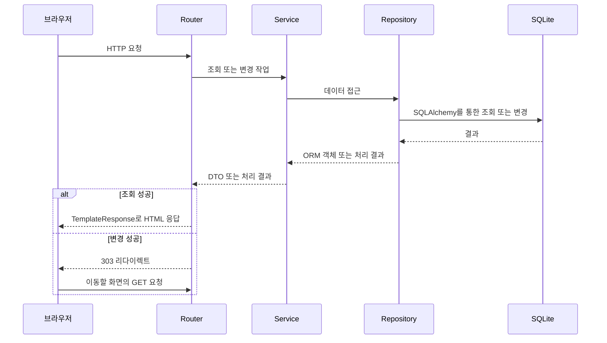

# 구조 및 요청 처리

## 계층별 역할

| 계층 | 역할 |
|---|---|
| Router | HTTP 요청 수신, 폼 파라미터 처리, HTML 응답 및 리다이렉트 |
| Service | 입력값 검증, 메모 존재 확인, CRUD 작업 흐름 및 DTO 변환 |
| Repository | SQLAlchemy Session을 통한 DB 조회 및 변경 |
| Model | SQLite 테이블과 컬럼에 대응하는 ORM 모델 |
| Template | 전달받은 데이터를 HTML로 렌더링 |

## 요청 처리 흐름

## GET과 POST 및 PRG

GET은 목록·상세 조회와 홈·등록·수정 폼 표시를 담당하며 데이터를 변경하지 않는다. POST는 메모 등록·수정·삭제를 담당한다.

변경 성공 후 `RedirectResponse`와 `status_code=303`을 사용해 GET 화면으로 이동한다. 이 흐름이 PRG(Post-Redirect-Get)이며, 결과 화면에서 새로고침할 때 이전 POST가 아닌 GET을 다시 요청하게 한다.

## 폼 입력과 서버 검증

브라우저가 `application/x-www-form-urlencoded` 형식으로 폼을 전송하면 라우터의 `Form()` 파라미터가 제목과 내용을 받는다. 누락된 필드는 빈 문자열로 받아 서비스에서 함께 검증한다.

| 필드 | 검증 규칙 |
|---|---|
| 제목 | 필수 입력, 최대 120자 |
| 내용 | 필수 입력, 최대 1,000자 |

실패 시 `MemoValidationError`에 정리된 입력값과 필드별 오류를 담아 전달한다. 라우터는 이를 HTML 폼에 표시하고 HTTP 422로 응답하며, DB에 잘못된 값을 저장하지 않는다.

## ORM, Session 및 DTO

`Memo` ORM 클래스는 SQLite의 `memos` 테이블에 대응한다. 저장소는 `select`, `add`, 속성 변경, `delete`로 데이터를 처리하고, 변경 작업의 `commit()`으로 트랜잭션을 DB에 반영한다.

`SessionLocal`의 `expire_on_commit=False`로 저장 후 객체 값을 유지한다. 현재 모델의 ID와 Python 기본값은 저장 과정에서 채워지므로 별도 `refresh()` 없이 DTO로 변환한다.

서비스는 ORM 객체를 dataclass 기반 `MemoDTO`로 변환해 전달한다. 폼 입력값은 `MemoFormData`로 관리하며, 라우터와 템플릿이 ORM 모델에 직접 의존하지 않도록 한다.

## 의존성 주입과 세션 정리

`Depends(get_db)`는 DB가 필요한 요청마다 세션을 제공하고 요청 종료 시 닫는다. `get_memo_service`는 해당 세션으로 `MemoRepository`와 `MemoService`를 구성해 라우터에 전달한다.
