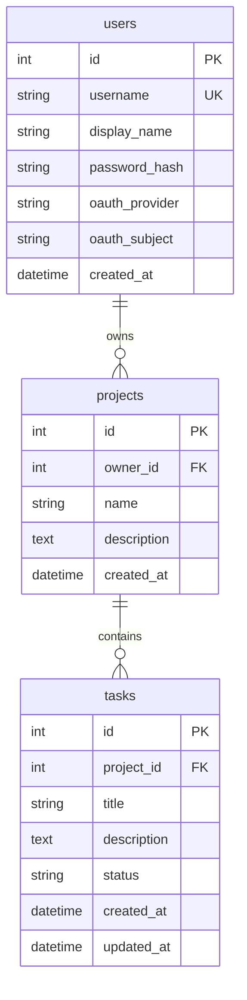

# 데이터베이스 ERD와 컬럼 설명

## ERD

- `PK`는 기본 키, `FK`는 외래 키, `UK`는 고유 제약을 가진 컬럼
- 사용자 한 명에 프로젝트 0개 이상, 프로젝트 하나에 할 일 0개 이상 연결 및 각 자식의 부모 1개 필수

## users

| 컬럼 | SQLAlchemy 타입 | NULL 허용 | 기본값·제약 | 설명 |
| --- | --- | --- | --- | --- |
| `id` | `Integer` | 아니요 | PK | 서비스 내부 사용자 식별자 |
| `username` | `String(50)` | 아니요 | 고유 인덱스 | 로컬 로그인 아이디, OAuth 계정에서는 충돌을 피하여 자동 생성 |
| `display_name` | `String(80)` | 아니요 | — | 화면에 표시할 닉네임 |
| `password_hash` | `String(255)` | 예 | — | 로컬 계정의 비밀번호 해시, OAuth 계정에서는 `NULL` |
| `oauth_provider` | `String(30)` | 예 | `oauth_subject`와 조합 고유 | 소셜 로그인 제공자 이름, 현재 `github` |
| `oauth_subject` | `String(100)` | 예 | `oauth_provider`와 조합 고유 | 제공자가 부여한 사용자 고유 ID, GitHub 사용자 ID의 문자열 표현 |
| `created_at` | `DateTime(timezone=True)` | 아니요 | 생성 시 현재 UTC 시각 | 계정 생성 시각 |

- `(oauth_provider, oauth_subject)` 조합에만 고유 제약 적용
- 로컬 계정의 두 값은 `NULL`로 SQLite에서 여러 계정 저장 가능
- GitHub 계정은 닉네임 변경과 관계없이 사용자 ID로 연결

## projects

| 컬럼 | SQLAlchemy 타입 | NULL 허용 | 기본값·제약 | 설명 |
| --- | --- | --- | --- | --- |
| `id` | `Integer` | 아니요 | PK | 프로젝트 식별자 |
| `owner_id` | `Integer` | 아니요 | FK → `users.id`, 인덱스, `ON DELETE CASCADE` | 소유 사용자 식별자 및 서비스의 소유권 검사 기준 |
| `name` | `String(100)` | 아니요 | — | 프로젝트 이름 |
| `description` | `Text` | 아니요 | 빈 문자열 | 프로젝트 설명 |
| `created_at` | `DateTime(timezone=True)` | 아니요 | 생성 시 현재 UTC 시각 | 프로젝트 생성 시각 |

## tasks

| 컬럼 | SQLAlchemy 타입 | NULL 허용 | 기본값·제약 | 설명 |
| --- | --- | --- | --- | --- |
| `id` | `Integer` | 아니요 | PK | 할 일 식별자 |
| `project_id` | `Integer` | 아니요 | FK → `projects.id`, 인덱스, `ON DELETE CASCADE` | 소속 프로젝트 식별자, 프로젝트를 통해 소유 사용자 확인 |
| `title` | `String(120)` | 아니요 | — | 할 일 제목 |
| `description` | `Text` | 아니요 | 빈 문자열 | 할 일 설명 |
| `status` | `String(20)` | 아니요 | `todo`, 인덱스 | `todo`(대기), `in_progress`(진행 중), `completed`(완료) |
| `created_at` | `DateTime(timezone=True)` | 아니요 | 생성 시 현재 UTC 시각 | 할 일 생성 시각 |
| `updated_at` | `DateTime(timezone=True)` | 아니요 | 생성 시 현재 UTC 시각, 수정 시 갱신 | 할 일 최종 수정 시각 |

- 문자열 상태 저장과 [TaskService](../services/task_service.py)의 값·중복 변경 검사
- DB Enum·CHECK 제약 미사용

변경 규칙은 [서비스 구조](architecture.md#상태-변경) 참고

## ORM 관계와 삭제 정책

아래 속성은 실제 DB 컬럼이 아닌 `relationship()`으로 정의한 객체 탐색 경로

| 양방향 속성 | 관계 |
| --- | --- |
| `User.projects` ↔ `Project.owner` | 사용자와 소유 프로젝트 |
| `Project.tasks` ↔ `Task.project` | 프로젝트와 할 일, 할 일 목록은 생성 시각 내림차순 |

- `back_populates`로 양방향 속성 연결
- `Task.status_label`은 상태의 한글 표시를 위한 계산 프로퍼티

부모 없는 자식 방지를 위한 연쇄 삭제 정책

- 사용자 삭제 시 프로젝트·할 일 삭제
- 프로젝트 삭제 시 소속 할 일 삭제
- 자식 삭제 시 부모 유지

삭제 처리 설정

- ORM `cascade="all, delete-orphan"`와 DB `ON DELETE CASCADE` 적용
- `passive_deletes=True`를 통한 로드되지 않은 자식의 삭제 처리 DB 위임
- [core/database.py](../core/database.py)에서 SQLite 연결별 외래 키 활성화

## 타입과 기본값 해석

- SQLAlchemy 선언 기준의 타입 표기, SQLite의 `id` 생략 시 자동 부여와 서비스의 `String(n)` 길이 검사
- SQLAlchemy `default`·`onupdate`를 통한 기본값·수정 시각 관리, DB 기본값·트리거 미사용
- 날짜의 UTC 생성과 SQLite의 `timezone=True` 설정만으로 시간대 정보 보존 보장 불가
