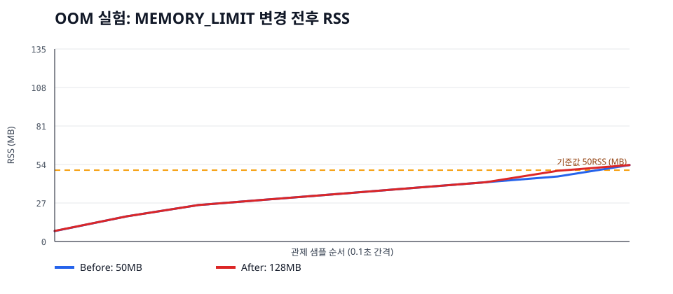
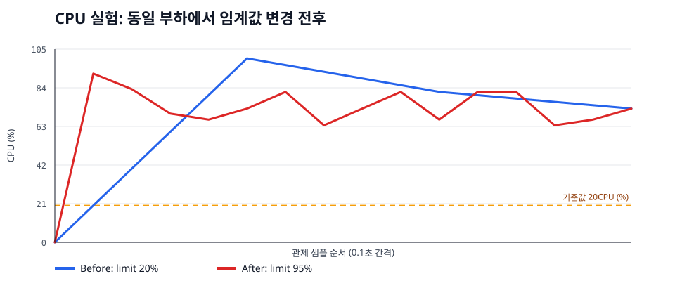
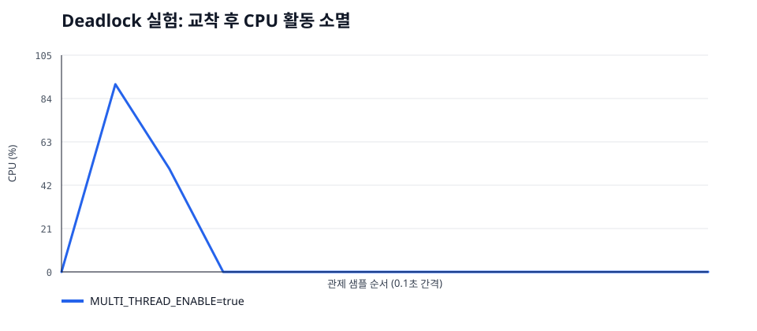
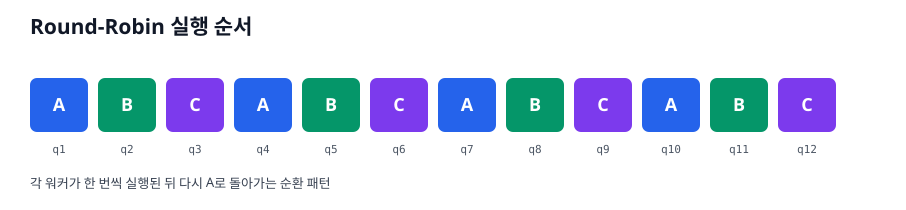

# Linux 시스템 장애 분석 및 트러블슈팅

## 프로젝트 개요 (Project Overview)

- Linux 환경에서 실행되는 `agent-leak-app`의 **메모리 누수/OOM**, **CPU 과점유**, **교착상태(Deadlock)**를 직접 재현하고 관제 데이터와 로그로 분석하는 프로젝트입니다.
- 장애를 단순 재부팅으로 넘기지 않고, 재현 경로와 객관적 증거를 바탕으로 근본 원인을 추론한 뒤 GitHub Issue 형식의 기술 리포트로 기록합니다.
- 제공 ZIP/바이너리가 저장소에 포함되지 않아 원본을 디컴파일하지 않고, 동일한 부트 조건·로그·보호 정책·장애 상태를 재현하는 Python 실습 앱을 독립 구현했습니다.
- **분석 원칙**: 관제 데이터와 로그를 먼저 수집하여 원인 증거를 보존한 뒤 조치합니다.
- **분야**: AI/SW 기초
- **구분**: Linux와 OS
- **학습 시간**: 40시간

## 실행 환경 (Environment)

- **운영체제**: Ubuntu 24.04 LTS (`ubuntu:24.04` Docker 이미지)
- **언어**: Python 3.11 이상
- **검증 런타임**: Python 3.13.15, Linux aarch64
- **대상 프로세스명**: `agent-leak-app`
- **실행 파일 래퍼**:
  - `bin/agent-app-leak-x86` (Intel/AMD64)
  - `bin/agent-app-leak-arm64` (Apple Silicon/ARM64)
- **실행 계정**: `root`가 아닌 일반 사용자
- **사용 도구**: `monitor.sh`, `ps`, `ps -L`, `kill` 등 Linux 표준 명령어
- **네트워크**: `0.0.0.0:15034` 실제 바인딩

## 프로젝트 구조 (Project Structure)

```text
.
├── README.md                         # 프로젝트 설명 및 완료 체크리스트
├── Dockerfile                       # 비루트 Linux 실습 이미지
├── compose.yaml                     # 개별 시나리오 실행 구성
├── Makefile                         # 테스트·증거 생성·검증 명령
├── bin/
│   ├── agent-leak-app               # 공통 실행 래퍼
│   ├── agent-app-leak-x86           # x86_64 실행 래퍼
│   └── agent-app-leak-arm64         # ARM64 실행 래퍼
├── src/agent_leak_app/
│   ├── config.py                    # 환경변수 및 부트 조건 검증
│   └── app.py                       # OOM·CPU·Deadlock·정상 시나리오
├── scripts/
│   ├── setup_lab.sh                 # 디렉터리·키·환경변수 초기화
│   ├── select_binary.sh             # 시스템 아키텍처별 래퍼 선택
│   ├── monitor.sh                   # CPU·RSS·상태·스레드 관제
│   ├── run_experiments.py           # 7개 Before/After 실험 자동화
│   ├── generate_charts.py           # 관제 로그 기반 SVG 생성
│   └── verify_requirements.py       # README 요구사항 자동 검증
├── tests/                            # 부트·설정·장애 통합 테스트
├── evidence/
│   ├── generated/                   # Linux 실행 로그·ps 출력·요약·해시
│   └── charts/                      # OOM·CPU·Deadlock·스케줄링 그래프
├── reports/
│   ├── oom-report.md                # 메모리 누수/OOM 분석
│   ├── cpu-report.md                # CPU 과점유 분석
│   ├── deadlock-report.md           # 교착상태 분석
│   └── scheduling-report.md         # 스케줄링 알고리즘 추론
└── .github/workflows/test.yml       # Linux CI 검증
```

## 빠른 실행 (Quick Start)

```bash
make docker-build
make docker-test
make docker-evidence
make verify
```

- 수동 실습 방법: [실습 실행 가이드](docs/USAGE.md)
- 증거 파일 설명: [증거 자료 인덱스](evidence/README.md)
- 장애 분석 문서: [리포트 인덱스](reports/README.md)

## 수행 항목 체크리스트

### 사전 준비 및 부트 검증

- [x] 제공 바이너리 미첨부 상태에서 독립 호환 실습 앱 구현
- [x] `x86_64`·`arm64` 실행 래퍼 및 자동 아키텍처 선택 스크립트 구현
- [x] `root` 실행 자동 거부
- [x] `AGENT_HOME` 필수 환경변수 검증
- [x] `AGENT_UPLOAD_DIR=$AGENT_HOME/upload_files` 경로·디렉터리 검증
- [x] `AGENT_KEY_PATH=$AGENT_HOME/api_keys` 경로·디렉터리 검증
- [x] `AGENT_LOG_DIR` 존재 및 쓰기 권한 검증
- [x] `$AGENT_HOME/api_keys/secret.key` 존재 검증
- [x] `secret.key` 내용 `agent_api_key_test` 검증
- [x] `AGENT_PORT=15034` 고정값 검증
- [x] `0.0.0.0:15034` 실제 소켓 바인딩 및 점유 충돌 검증
- [x] `MEMORY_LIMIT` 정수·`50~512MB` 범위 검증
- [x] `CPU_MAX_OCCUPY` 정수·`10~100%` 범위 검증
- [x] `MULTI_THREAD_ENABLE`의 `true/false`, `1/0`, `yes/no` 처리
- [x] 필수 조건 실패 시 원인이 포함된 부트 실패 메시지와 종료 코드 `2` 반환
- [x] 유효한 설정에서 부트 시퀀스 및 고정 포트 바인딩 정상 통과

### 메모리 누수 및 OOM 분석

- [x] `monitor.sh`로 대상 프로세스의 RSS를 0.1초 간격으로 관측
- [x] RSS가 6.0MB에서 48.5MB 이상으로 상승하는 패턴 기록
- [x] 프로세스 종료 직전·직후 애플리케이션 로그 수집
- [x] `Memory limit exceeded` 로그 식별
- [x] `SELF-TERMINATED` 로그 식별
- [x] 힙 객체 참조 유지와 MemoryGuard 정책의 동작 원리 분석
- [x] `MEMORY_LIMIT=50` 기준 실험 수행 및 종료 코드 `137` 확인
- [x] `MEMORY_LIMIT=128` 비교 실험 수행 및 종료 코드 `0` 확인
- [x] 설정 변경 전후 RSS·생존 결과 비교 그래프 생성
- [x] [OOM 장애 분석 리포트](reports/oom-report.md) 작성

### CPU 과점유 분석

- [x] `/proc`, `ps`, `monitor.sh`로 대상 프로세스의 순간 CPU 사용률 관측
- [x] 시스템 전체 부하가 아닌 `agent-leak-app` 프로세스의 CPU 급상승 식별
- [x] CPU 사용률 급상승 구간을 수치와 SVG 그래프로 기록
- [x] `WATCHDOG` 및 `SIGTERM` 종료 로그 식별
- [x] Watchdog의 프로세스 CPU 측정 및 보호 종료 원리 분석
- [x] 동일한 75% 목표 부하에서 `CPU_MAX_OCCUPY=20` 기준 실험 수행
- [x] `CPU_MAX_OCCUPY=95` 비교 실험 수행
- [x] 설정 변경 전후 종료 코드 `143→0`과 생존 결과 비교
- [x] [CPU 과점유 장애 분석 리포트](reports/cpu-report.md) 작성

### 교착상태(Deadlock) 진단

- [x] `ps -ef`로 무응답 상태에서도 프로세스 PID가 유지됨을 확인
- [x] `ps -L`로 메인·워커 스레드 3개와 워커 CPU `0.0%` 확인
- [x] 관제 로그에서 교착 후 CPU `0.0%`, RSS `20.5MB` 정체 확인
- [x] 로그 출력이 멈춘 마지막 지점 수집
- [x] `WAITING`, `BLOCKED`, `DEADLOCK DETECTED` 로그 식별
- [x] Thread-A와 Thread-B의 상반된 락 획득 순서 및 순환 대기 증명
- [x] 상호 배제·점유 대기·비선점·순환 대기의 4대 조건 분석
- [x] `MULTI_THREAD_ENABLE=true`에서 PID가 1.5초 이상 유지되는 데드락 재현
- [x] `MULTI_THREAD_ENABLE=false`에서 순차 락 획득 및 정상 완료 확인
- [x] 설정 변경 전후 종료 여부와 스레드 상태 비교
- [x] [교착상태 장애 분석 리포트](reports/deadlock-report.md) 작성

### 장애 리포트 공통 작성 기준

- [x] 장애 시점과 조건을 포함한 발생 현상 작성
- [x] 재현 명령과 환경변수를 포함한 재현 경로 작성
- [x] 관제 로그, 실행 로그, `ps`/`ps -L` 출력, SVG 그래프 첨부
- [x] 수집한 증거를 근거로 근본 원인 분석
- [x] 메모리·CPU 스케줄링·락과 관련된 OS 동작 원리 설명
- [x] 환경변수 조정에 따른 임시 조치 기록
- [x] 조치 전후 결과를 수치·종료 코드·그래프로 비교
- [x] 각 리포트에 근본 해결을 위한 추가 제안 작성
- [x] OOM, CPU, Deadlock 리포트 총 3건 완성

## 장애 유형별 필수 증거

| 장애 유형 | 필수 증거 | 결과 |
| --- | --- | --- |
| OOM | 메모리 상승 관제, 임계값 및 자기 종료 로그, `MEMORY_LIMIT` 전후 실행 | [로그·그래프](evidence/README.md#장애별-증거) |
| CPU | CPU 급상승 관제, Watchdog `SIGTERM` 로그, `CPU_MAX_OCCUPY` 전후 실행 | [로그·그래프](evidence/README.md#장애별-증거) |
| Deadlock | PID 존재, `ps -L` 스레드 정체, 마지막 `WAITING/BLOCKED` 로그, 락 대기 근거 | [로그·ps 출력·그래프](evidence/README.md#장애별-증거) |

## 보너스 과제

### 스케줄링 알고리즘 추론

- [x] 정상 실행 상태에서 Thread-A·B·C 작업 로그 수집
- [x] 타임스탬프와 실행 순서를 기준으로 교체 패턴 분석
- [x] 작업 완료 전에 다른 작업이 실행되는 선점형 패턴 확인
- [x] FCFS·Priority를 배제하고 Round-Robin으로 추론
- [x] A→B→C 순환 로그와 동일 작업량을 근거로 제시
- [x] Round-Robin의 장점과 문맥 교환 비용 분석
- [x] 대화형 웹 서버와 순차 배치 처리의 적합성 비교
- [x] [스케줄링 알고리즘 추론 리포트](reports/scheduling-report.md) 작성

## 제약 사항 (Constraints)

- 바이너리를 디컴파일하거나 리버스 엔지니어링하지 않습니다.
- 실습 앱은 비루트 Docker 컨테이너 또는 격리된 로컬 환경에서 실행합니다.
- 공유 네트워크에서는 방화벽 설정과 `15034` 포트 노출에 유의합니다.
- 관제와 진단에는 Linux 표준 명령어와 Python 표준 라이브러리만 사용합니다.
- 외부 Python 패키지 없이 실행·테스트·증거 생성을 완료합니다.
- 실습용 메모리/CPU 부하는 운영 서버에서 실행하지 않습니다.

## 커스텀 설정값 명세

| 항목 | 기준값 | 비고 |
| --- | --- | --- |
| `AGENT_HOME` | 필수 설정 | 애플리케이션 기준 경로 |
| `AGENT_PORT` | `15034` | 고정값, `0.0.0.0` 바인딩 |
| `AGENT_UPLOAD_DIR` | `$AGENT_HOME/upload_files` | 디렉터리 존재 필수 |
| `AGENT_KEY_PATH` | `$AGENT_HOME/api_keys` | 경로 존재 필수 |
| `AGENT_LOG_DIR` | 사용자 지정 로그 경로 | 존재 및 쓰기 권한 필수 |
| `MEMORY_LIMIT` | `50~512` | 정수, 단위 MB |
| `CPU_MAX_OCCUPY` | `10~100` | 정수, 단위 % |
| `MULTI_THREAD_ENABLE` | `true/false` | `1/0`, `yes/no`도 허용 |
| `secret.key` | `agent_api_key_test` | `$AGENT_HOME/api_keys/secret.key`에 저장 |
| `AGENT_SCENARIO` | `normal` | `normal`, `memory`, `cpu`, `deadlock` |
| `AGENT_RUN_SECONDS` | `2.0` | 자동 실험 실행 시간 |
| `CPU_LOAD_PERCENT` | `75` | CPU 실습 목표 부하 |

## 검증 (Verification)

```bash
make docker-test     # Linux 컨테이너에서 단위·통합 테스트 실행
make docker-evidence # 7개 실험 및 증거·그래프 재생성
make verify          # README 요구사항과 SHA-256 무결성 검사
```

현재 검증 결과:

- **테스트**: 14개 통과
- **Linux 실험**: 7개 통과
- **검증된 증거 파일**: 21개
- **요구사항 검사**: PASS
- **CI**: GitHub Actions에서 Linux 테스트 및 증거 검증 자동 실행

## 결과물 (Deliverables)

- [x] [OOM Crash 분석 리포트](reports/oom-report.md)
- [x] [CPU Latency 분석 리포트](reports/cpu-report.md)
- [x] [Deadlock 분석 리포트](reports/deadlock-report.md)
- [x] [로그·명령어 출력·그래프 증거 자료](evidence/README.md)
- [x] [환경변수 변경 전후 자동 비교 결과](evidence/generated/summary.json)
- [x] [스케줄링 알고리즘 추론 리포트](reports/scheduling-report.md)
- [x] 제출용 GitHub Repository: [myy-dev/B1-2](https://github.com/myy-dev/B1-2)

### 결과 그래프

| OOM 메모리 | CPU 과점유 |
| --- | --- |
|  |  |

| Deadlock CPU/RSS | Round-Robin 순서 |
| --- | --- |
|  |  |

## 완료 기준

이 저장소의 구현·테스트·증거·리포트를 통해 다음 내용을 설명하고 재현할 수 있습니다.

- 메모리 구조와 메모리 누수가 프로세스 및 시스템에 미치는 영향
- 특정 프로세스의 CPU 과점유가 시스템 지연을 유발하는 원리
- 교착상태의 4대 조건과 Linux 도구를 활용한 진단 방법
- 관제 데이터와 로그를 근거로 장애 원인을 추론하는 방법
- GitHub Issue 형식으로 장애 상황과 조치 결과를 공유하는 방법
