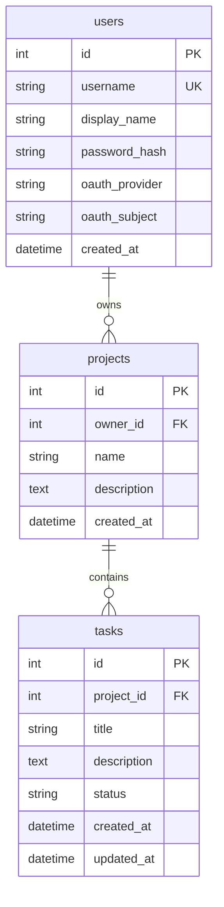

# 데이터베이스 ERD와 컬럼 설명

[User](../models/user.py), [Project](../models/project.py), [Task](../models/task.py)의 SQLAlchemy 모델 기준.

## ERD

- `PK`는 기본 키, `FK`는 외래 키, `UK`는 고유 제약을 가진 컬럼.
- 사용자 한 명에 프로젝트 0개 이상, 프로젝트 하나에 할 일 0개 이상 연결.
- 각 프로젝트에 소유 사용자 1명, 각 할 일에 소속 프로젝트 1개 필수.
- `users`의 `(oauth_provider, oauth_subject)`는 두 컬럼을 합친 고유 제약. 각 컬럼 단독의 고유 제약은 없음.

## users

로그인 계정과 화면에 표시할 사용자 정보 저장.

| 컬럼 | SQLAlchemy 타입 | NULL 허용 | 기본값·제약 | 설명 |
| --- | --- | --- | --- | --- |
| `id` | `Integer` | 아니요 | PK, SQLite에서 생략 시 ID 자동 부여 | 서비스 내부 사용자 식별자 |
| `username` | `String(50)` | 아니요 | 고유 인덱스 | 로컬 로그인 아이디, OAuth 계정에서는 충돌을 피하여 자동 생성 |
| `display_name` | `String(80)` | 아니요 | — | 화면에 표시할 닉네임 |
| `password_hash` | `String(255)` | 예 | — | 로컬 계정의 비밀번호 해시, OAuth 계정에서는 `NULL` |
| `oauth_provider` | `String(30)` | 예 | `oauth_subject`와 조합 고유 | 소셜 로그인 제공자 이름, 현재 `github` |
| `oauth_subject` | `String(100)` | 예 | `oauth_provider`와 조합 고유 | 제공자가 부여한 사용자 고유 ID, GitHub 사용자 ID의 문자열 표현 |
| `created_at` | `DateTime(timezone=True)` | 아니요 | 생성 시 현재 UTC 시각 | 계정 생성 시각 |

`uq_user_oauth_identity`는 `(oauth_provider, oauth_subject)` 조합의 고유 제약 이름. GitHub의 닉네임 변경과 관계없이 같은 사용자 ID를 기존 계정에 연결.

로컬 계정의 OAuth 컬럼은 `NULL`. SQLite는 고유 제약의 `NULL` 값을 서로 중복으로 취급하지 않으므로 여러 로컬 계정 저장 가능.

## projects

사용자가 소유하는 프로젝트 정보 저장.

| 컬럼 | SQLAlchemy 타입 | NULL 허용 | 기본값·제약 | 설명 |
| --- | --- | --- | --- | --- |
| `id` | `Integer` | 아니요 | PK, SQLite에서 생략 시 ID 자동 부여 | 프로젝트 식별자 |
| `owner_id` | `Integer` | 아니요 | FK → `users.id`, 인덱스, `ON DELETE CASCADE` | 소유 사용자 식별자 및 서비스의 소유권 검사 기준 |
| `name` | `String(100)` | 아니요 | — | 프로젝트 이름 |
| `description` | `Text` | 아니요 | 빈 문자열 | 프로젝트 설명 |
| `created_at` | `DateTime(timezone=True)` | 아니요 | 생성 시 현재 UTC 시각 | 프로젝트 생성 시각 |

## tasks

프로젝트에 속한 할 일과 진행 상태 저장.

| 컬럼 | SQLAlchemy 타입 | NULL 허용 | 기본값·제약 | 설명 |
| --- | --- | --- | --- | --- |
| `id` | `Integer` | 아니요 | PK, SQLite에서 생략 시 ID 자동 부여 | 할 일 식별자 |
| `project_id` | `Integer` | 아니요 | FK → `projects.id`, 인덱스, `ON DELETE CASCADE` | 소속 프로젝트 식별자, 프로젝트를 통해 소유 사용자 확인 |
| `title` | `String(120)` | 아니요 | — | 할 일 제목 |
| `description` | `Text` | 아니요 | 빈 문자열 | 할 일 설명 |
| `status` | `String(20)` | 아니요 | `todo`, 인덱스 | `todo`(대기), `in_progress`(진행 중), `completed`(완료) |
| `created_at` | `DateTime(timezone=True)` | 아니요 | 생성 시 현재 UTC 시각 | 할 일 생성 시각 |
| `updated_at` | `DateTime(timezone=True)` | 아니요 | 생성 시 현재 UTC 시각, 수정 시 갱신 | 할 일 최종 수정 시각 |

상태 컬럼은 문자열로 저장하며, [TaskService](../services/task_service.py)에서 정의된 상태 값인지와 중복 변경 여부를 검사. 대기·진행 중·완료 사이의 모든 상태 변경 허용. DB의 Enum 또는 CHECK 제약으로 제한하는 구조는 아님.

## ORM 관계와 삭제 정책

아래 속성은 실제 DB 컬럼이 아닌 `relationship()`으로 정의한 객체 탐색 경로.

| 모델 속성 | 연결 대상 | 역할 |
| --- | --- | --- |
| `User.projects` | `Project.owner` | 사용자가 소유한 프로젝트 목록 |
| `Project.owner` | `User.projects` | 프로젝트의 소유 사용자 |
| `Project.tasks` | `Task.project` | 프로젝트의 할 일 목록, 생성 시각 내림차순 정렬 |
| `Task.project` | `Project.tasks` | 할 일이 속한 프로젝트 |

`back_populates`로 양방향 속성 연결. `Task.status_label`도 DB 컬럼이 아닌 상태의 한글 표시를 위한 계산 프로퍼티.

소유자 없는 프로젝트와 소속 프로젝트 없는 할 일 방지를 위한 연쇄 삭제 정책 적용.

- 사용자 삭제 시 프로젝트와 그에 속한 할 일 삭제.
- 프로젝트 삭제 시 해당 프로젝트의 할 일 삭제.
- 할 일 삭제 시 사용자와 프로젝트 유지.

ORM의 `cascade="all, delete-orphan"`와 외래 키의 `ON DELETE CASCADE`로 삭제 처리. `passive_deletes=True`를 통해 로드되지 않은 자식의 삭제를 DB에 위임하며, SQLite 외래 키 제약은 [core/database.py](../core/database.py)에서 연결마다 활성화.

## 타입과 기본값 해석

- 표의 타입은 SQLAlchemy 모델 선언 기준. SQLite는 `String(n)`의 길이를 자체 강제하지 않으며 입력 길이는 서비스 계층에서 검사.
- 빈 문자열·상태·생성 시각 기본값은 SQLAlchemy의 `default` 설정이며 DB의 `server_default` 설정은 아님.
- `updated_at`의 자동 갱신은 SQLAlchemy의 `onupdate` 설정이며 DB 트리거는 아님.
- 날짜는 애플리케이션에서 UTC로 생성. SQLite의 저장 형식은 시간대 정보를 그대로 보존하지 않으므로 `timezone=True`만으로 시간대 보존을 보장하지 않음.
