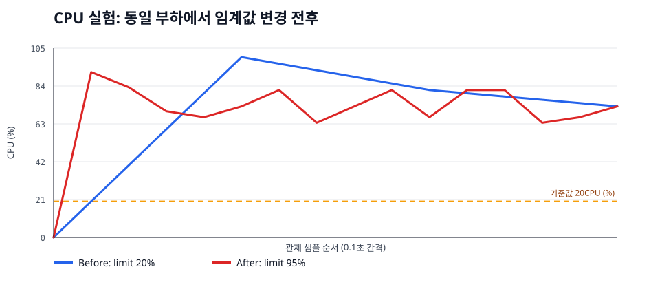

# [Bug] CPU Latency - CPU 과점유로 Watchdog 보호 종료가 발생함

## 1. Description (현상 설명)

`CPU_LOAD_PERCENT=75`, `CPU_MAX_OCCUPY=20` 조건으로 실행하면 특정 프로세스의 CPU 사용률이 임계값을 초과합니다. Watchdog은 이를 시스템 지연 위험으로 판단하고 `SIGTERM` 보호 종료를 수행합니다.

### 재현 절차

```bash
make docker-build
make docker-evidence
```

개별 재현 명령은 다음과 같습니다.

```bash
AGENT_SCENARIO=cpu CPU_LOAD_PERCENT=75 CPU_MAX_OCCUPY=20 ./bin/agent-leak-app
```

## 2. Evidence & Logs (증거 자료)



`monitor.sh`는 대상 `python3` 프로세스의 CPU 사용률이 72.7~90.9% 범위까지 상승한 구간을 기록했습니다. 동일 시점 RSS는 약 13.6MB로 유지되어 메모리 장애와 구분됩니다.

```text
[Watchdog] START limit=20% target_load=75%
[Watchdog] CPU=80.5% LIMIT=20%
[CRITICAL] [Watchdog] CPU threshold exceeded (80.5% >= 20%)
[CRITICAL] >>> [SYSTEM] WATCHDOG: INITIATING EMERGENCY ABORT (SIGTERM) <<<
```

- [Before 애플리케이션 로그](../evidence/generated/cpu-before.log)
- [Before 관제 로그](../evidence/generated/cpu-before-monitor.log)
- [After 애플리케이션 로그](../evidence/generated/cpu-after.log)
- [After 관제 로그](../evidence/generated/cpu-after-monitor.log)
- [전체 실험 요약](../evidence/generated/summary.json)

## 3. Root Cause Analysis (원인 분석)

CPU 시나리오는 0.1초 주기 중 약 75%를 계산 루프에 사용합니다. 이 작업은 I/O 대기 없이 반복 연산하므로 대상 프로세스가 한 CPU 코어의 실행 시간을 지속적으로 소비합니다. 스케줄러가 다른 프로세스에도 시간을 배분하지만, 실행 큐가 길어지면 전체 응답 지연이 커질 수 있습니다.

Watchdog은 `time.process_time()`의 증가량을 벽시계 시간과 비교하여 프로세스 CPU 사용률을 구합니다. 측정값이 `CPU_MAX_OCCUPY` 이상이면 로그를 남기고 실제 `SIGTERM`을 전달합니다. 따라서 이번 종료는 예외나 충돌이 아니라 정의된 시스템 보호 조치입니다.

## 4. Workaround & Verification (조치 및 검증)

부하는 75%로 고정하고 `CPU_MAX_OCCUPY`만 20%에서 95%로 변경했습니다.

| 항목 | Before | After |
| --- | --- | --- |
| 목표 부하 | 75% | 75% |
| `CPU_MAX_OCCUPY` | 20% | 95% |
| Watchdog 측정 | 80.5% | 65.4~79.9% |
| 결과 | `SIGTERM` 보호 종료 | 1.5초 실험 정상 완료 |
| 종료 코드 | 143 | 0 |

임계값 상향은 부하를 없애지 않습니다. 근본 해결은 계산 작업을 작은 단위로 나누고, 작업 큐·프로세스 풀·레이트 리밋을 적용해 CPU 시간을 제어하는 것입니다.
