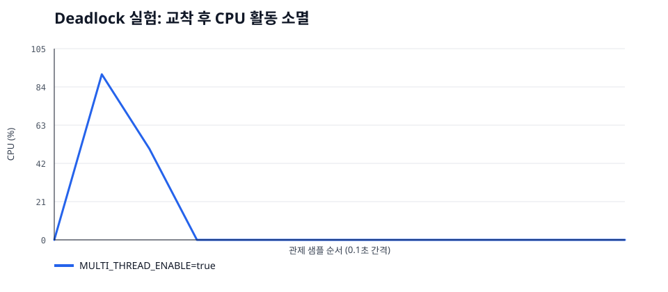
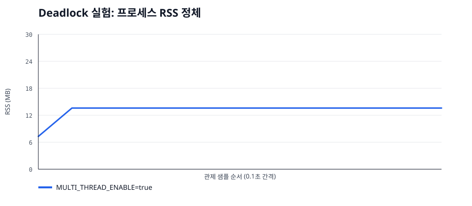

# [Bug] Deadlock - 멀티스레드의 순환 락 대기로 프로세스가 무응답 상태가 됨

## 1. Description (현상 설명)

`MULTI_THREAD_ENABLE=true`로 Deadlock 시나리오를 실행하면 프로세스 PID는 유지되지만 작업 로그가 멈춥니다. 자동 실험기는 1.5초 후에도 프로세스가 살아 있음을 확인했고, 증거를 수집한 뒤 실습 프로세스를 정리했습니다.

### 재현 절차

```bash
make docker-build
make docker-evidence
```

개별 재현 명령은 다음과 같습니다.

```bash
AGENT_SCENARIO=deadlock MULTI_THREAD_ENABLE=true ./bin/agent-leak-app
```

## 2. Evidence & Logs (증거 자료)





`ps -ef`는 PID `1188`이 존재함을 보여주고, `ps -L`은 메인 스레드와 두 워커 스레드가 살아 있으면서 워커 CPU가 각각 `0.0%`임을 보여줍니다. PID는 실행마다 달라질 수 있습니다.

```text
$ ps -L -p 1188 -o pid,tid,pcpu,pmem,stat,comm
  PID   TID %CPU %MEM STAT COMMAND
 1188  1188  2.0  0.1 Sl   python3
 1188  1225  0.0  0.1 Sl   python3
 1188  1226  0.0  0.1 Sl   python3
```

교착 후 관제 로그는 CPU `0.0%`, RSS `13.6MB`, 스레드 3개가 반복적으로 유지되는 정체 상태를 기록했습니다.

```text
[Thread-B] WAITING for Resource-A; state=BLOCKED
[Thread-A] WAITING for Resource-B; state=BLOCKED
[DeadlockLab] DEADLOCK DETECTED: ... threads remain BLOCKED; log output stops here
```

- [Before 애플리케이션 로그](../evidence/generated/deadlock-before.log)
- [Before 관제 로그](../evidence/generated/deadlock-before-monitor.log)
- [`ps -ef` 및 `ps -L` 출력](../evidence/generated/deadlock-before-ps.txt)
- [After 애플리케이션 로그](../evidence/generated/deadlock-after.log)
- [전체 실험 요약](../evidence/generated/summary.json)

## 3. Root Cause Analysis (원인 분석)

Thread-A는 Resource-A를 획득한 뒤 Resource-B를 기다리고, Thread-B는 Resource-B를 획득한 뒤 Resource-A를 기다립니다. 두 락을 강제로 회수하거나 대기를 취소하는 코드가 없어 순환 대기가 영구적으로 지속됩니다.

교착상태의 4대 조건이 모두 성립합니다.

1. **상호 배제**: 각 락은 한 스레드만 소유할 수 있습니다.
2. **점유 대기**: 각 스레드는 하나의 락을 보유한 채 다른 락을 기다립니다.
3. **비선점**: 다른 스레드가 소유한 락을 강제로 빼앗을 수 없습니다.
4. **순환 대기**: A→B, B→A의 대기 고리가 형성됩니다.

이는 식사하는 철학자들 문제와 같은 구조입니다. 프로세스가 종료되지 않고 CPU와 RSS가 정체되며 마지막 로그가 `WAITING/BLOCKED`인 세 증거가 같은 결론을 지지합니다.

## 4. Workaround & Verification (조치 및 검증)

`MULTI_THREAD_ENABLE=false`로 변경하여 동일한 작업을 한 스레드에서 순차 실행했습니다.

| 항목 | Before | After |
| --- | --- | --- |
| `MULTI_THREAD_ENABLE` | `true` | `false` |
| 스레드 동작 | 서로 반대 순서로 락 획득 | 한 스레드에서 순차 획득 |
| 결과 | 1.5초 후에도 PID 유지·무응답 | 두 작업 모두 즉시 완료 |
| 종료 코드 | 외부 정리 전까지 종료하지 않음 | 0 |

근본 해결은 모든 스레드가 락을 동일한 순서로 획득하도록 규칙을 통일하거나, 타임아웃이 있는 락 획득과 실패 시 롤백을 적용하는 것입니다.
