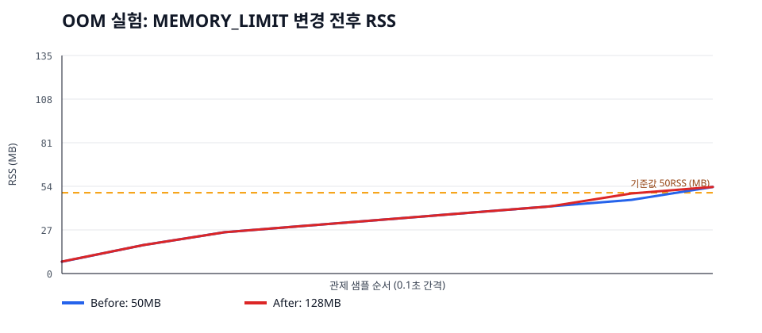

# [Bug] OOM Crash - 메모리 누적으로 MemoryGuard가 프로세스를 종료함

## 1. Description (현상 설명)

`MEMORY_LIMIT=50`으로 `agent-leak-app`의 메모리 시나리오를 실행하면 RSS가 지속적으로 증가합니다. 부트 성공 약 0.94초 후 RSS가 53.6MB에 도달하면서 MemoryGuard가 프로세스를 종료하며, 자동 실험에서 종료 코드 `137`을 확인했습니다.

### 재현 절차

```bash
make docker-build
make docker-evidence
```

개별 재현 명령은 다음과 같습니다.

```bash
AGENT_SCENARIO=memory MEMORY_LIMIT=50 AGENT_RUN_SECONDS=2 ./bin/agent-leak-app
```

## 2. Evidence & Logs (증거 자료)



관제 로그는 RSS가 7.3MB에서 53.6MB까지 증가하는 흐름을 기록했습니다.

```text
PROCESS:python3 ... RSS:37.6MB ...
PROCESS:python3 ... RSS:41.6MB ...
PROCESS:python3 ... RSS:45.6MB ...
PROCESS:python3 ... RSS:53.6MB ...
```

애플리케이션 내부 관측은 임계값을 넘은 마지막 할당까지 기록했습니다.

```text
[MemoryGuard] RSS=49.6MB LIMIT=50MB chunks=9
[MemoryGuard] RSS=53.6MB LIMIT=50MB chunks=10
[CRITICAL] [MemoryGuard] Memory limit exceeded (53.6MB >= 50MB)
[CRITICAL] >>> [SYSTEM] SELF-TERMINATED (Memory Limit Exceeded) <<<
```

- [Before 애플리케이션 로그](../evidence/generated/oom-before.log)
- [Before 관제 로그](../evidence/generated/oom-before-monitor.log)
- [After 애플리케이션 로그](../evidence/generated/oom-after.log)
- [After 관제 로그](../evidence/generated/oom-after-monitor.log)
- [전체 실험 요약](../evidence/generated/summary.json)

## 3. Root Cause Analysis (원인 분석)

메모리 시나리오는 매 주기 4MB의 `bytearray`를 만들고 리스트에 계속 보관합니다. 리스트가 객체 참조를 유지하므로 가비지 컬렉터가 해당 힙 메모리를 회수할 수 없습니다. 그 결과 RSS가 계단식으로 증가합니다.

Linux에서 프로세스의 가상 주소 공간에 페이지가 할당되고 실제로 쓰이면 물리 메모리의 RSS에 반영됩니다. 이 앱의 MemoryGuard는 RSS가 `MEMORY_LIMIT`에 도달했는지 확인하고 시스템 전체 메모리 고갈을 막기 위해 프로세스를 종료합니다. 이는 커널 OOM Killer가 아니라 애플리케이션 내부 보호 정책입니다.

## 4. Workaround & Verification (조치 및 검증)

`MEMORY_LIMIT`을 50MB에서 128MB로 변경하고 동일한 4MB/0.1초 누수 조건으로 비교했습니다.

| 항목 | Before | After |
| --- | --- | --- |
| `MEMORY_LIMIT` | 50MB | 128MB |
| 실행 조건 | 4MB/0.1초 할당 | 동일 |
| 관측된 최대 RSS | 53.6MB (앱 로그) | 53.6MB (앱 로그) |
| 결과 | MemoryGuard 종료 | 설정된 실험 시간 정상 완료 |
| 종료 코드 | 137 | 0 |

임계값 상향은 생존 시간을 늘리는 임시 조치일 뿐 누수를 제거하지 않습니다. 근본 해결은 사용 완료 데이터를 리스트에서 제거하고, 장기 실행 테스트에서 RSS가 정상 범위로 돌아오는지 확인하는 것입니다.
