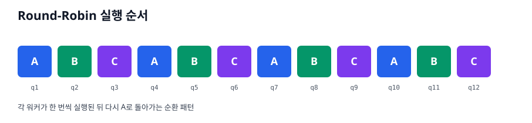

# [Analysis] 로그 패턴 분석을 통한 스케줄링 알고리즘 추론

## 1. 로그 관찰 개요

정상 실행 모드에서 Thread-A, Thread-B, Thread-C의 작업 진행 로그를 수집했습니다. 각 작업은 25%씩 진행되며 한 작업이 끝나기 전에 다음 작업으로 전환됩니다.

## 2. 증거 자료



```text
[Thread-A] Task Started. Calculating... (25%)
[Thread-B] Task Started. Calculating... (25%)
[Thread-C] Task Started. Calculating... (25%)
[Thread-A] Resumed. Calculating... (50%)
[Thread-B] Resumed. Calculating... (50%)
[Thread-C] Resumed. Calculating... (50%)
```

- [전체 스케줄링 로그](../evidence/generated/scheduling-round-robin.log)
- [스케줄링 관제 로그](../evidence/generated/scheduling-round-robin-monitor.log)

## 3. 패턴 분석 및 결론

- **FCFS 배제**: Thread-A가 100% 완료되기 전에 B와 C가 실행되므로 먼저 도착한 작업을 끝까지 처리하는 방식이 아닙니다.
- **Priority 배제**: 특정 스레드가 연속으로 실행되거나 더 자주 선택되지 않습니다.
- **Round-Robin 부합**: A→B→C 순서를 반복하고 각 워커가 동일한 25% 작업 단위를 처리합니다.

따라서 관측된 애플리케이션 작업 배분 정책은 **Round-Robin**으로 판단합니다. 이 결론은 앱이 출력한 `policy=round-robin`, `quantum=0.03s` 진단 로그와도 일치합니다.

## 4. 장단점 및 적합한 아키텍처

| 구분 | 분석 |
| --- | --- |
| 장점 | 작업마다 공평한 실행 기회를 제공하고 긴 작업 하나가 전체를 독점하는 것을 막습니다. |
| 단점 | 시간 할당량이 너무 짧으면 문맥 교환 비용이 커지고, 너무 길면 응답성이 떨어집니다. |
| 적합 | 여러 요청에 빠르게 응답해야 하는 대화형 웹 서버, 시분할 시스템 |
| 덜 적합 | 작업 전환 비용이 크고 총 처리량이 더 중요한 순차 배치 처리 |
